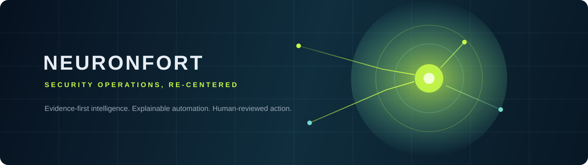

# NeuronFort Security

> Evidence-first security operations, thoughtful automation, and practical security learning.

[Website](https://neuronfort.online/) · [Security policy](SECURITY.md) · [Contributing](CONTRIBUTING.md) · [Learning path](docs/learning-path.md)

## Building security operations people can trust

NeuronFort is an early cybersecurity startup building toward an AI-assisted security operations workspace for small security teams and MSPs. Our product direction is simple: give analysts clearer evidence, use automation for repeatable work, and keep meaningful decisions visible and human-reviewed.

This public repository is the NeuronFort learning and community hub. It shares practical defensive-security resources, transparent contribution guidance, and the principles behind responsible security work.

## What we are working toward

| Focus | What it means at NeuronFort |
| --- | --- |
| **Evidence first** | Alerts should arrive with the context needed to understand them. |
| **Explainable automation** | Automation should make repeatable work faster, not hide why a decision was made. |
| **Human control** | High-impact actions must remain reviewable and explicitly approved by people. |
| **Safe by design** | Tenant boundaries, authorization, and auditability belong in the foundation. |

## Explore the hub

| Start here | What you will find |
| --- | --- |
| [Defensive learning path](docs/learning-path.md) | A practical four-week route through networking, labs, documentation, and defensive fundamentals. |
| [Tool evaluation guide](docs/tool-evaluation.md) | A repeatable way to assess whether a security tool is appropriate, sustainable, and safe to use. |
| [Contributing guide](CONTRIBUTING.md) | How to suggest resources, improve docs, or help shape the hub. |
| [Security policy](SECURITY.md) | The responsible way to report a vulnerability in this repository or related project infrastructure. |

## NeuronFort ecosystem

| Destination | Purpose |
| --- | --- |
| [neuronfort.online](https://neuronfort.online/) | Product story, security operations vision, and early startup progress. |
| **This repository** | Public learning resources, responsible-practice guidance, and community contribution. |
| [Security policy](SECURITY.md) | Private, responsible vulnerability reporting route. |

## Responsible security, always

Use security tools only on systems you own or where you have explicit written authorization to assess them. NeuronFort supports defensive learning, safe testing, responsible disclosure, and improvement—not unauthorized access, disruption, credential theft, or evasion.

For anyone beginning their security journey, we recommend starting with the [learning path](docs/learning-path.md), practicing in a safe lab, and documenting what you learn.

## Contribute

We welcome well-sourced, practical additions that help people protect systems responsibly. Before opening a pull request, read [CONTRIBUTING.md](CONTRIBUTING.md) and [CODE_OF_CONDUCT.md](CODE_OF_CONDUCT.md).

- Suggest a learning resource or correction with an issue.
- Add context to an existing resource using the [tool evaluation guide](docs/tool-evaluation.md).
- Report security issues privately through [SECURITY.md](SECURITY.md)—never post sensitive details in a public issue.

## Status

NeuronFort is in an early product-building stage. Public materials here are educational and community-focused; they are not a managed security service, a production monitoring platform, or a substitute for a professional assessment.

## License

Unless noted otherwise, the written content in this repository is available under the [MIT License](LICENSE).
